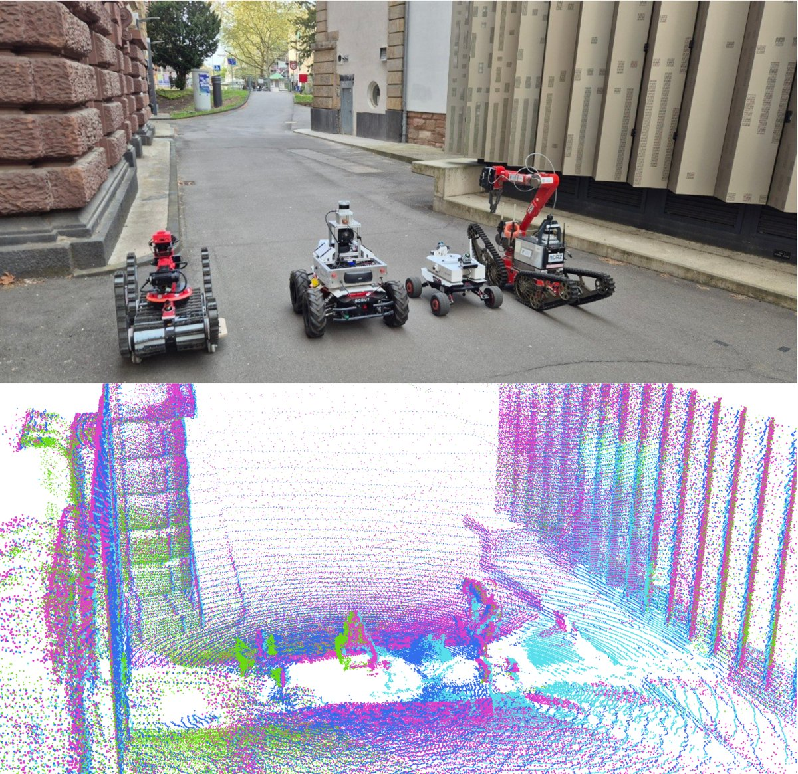

# I See You: Initial Multi-Robot LiDAR Registration with Mutual-Observation Checks

Jonathan Lichtenfeld, Oskar von Stryk — SIM Group, Technical University of Darmstadt

IEEE International Symposium on Safety, Security, and Rescue Robotics (SSRR) 2026

**Project page:** https://tu-darmstadt-ros-pkg.github.io/i-see-you-registration

<p align="center">
  
</p>

Infrastructure-free, pre-mission registration of a multi-robot team from a single LiDAR snapshot per robot.
Pairwise global registration is followed by physical plausibility checks — chassis bounding-box overlap and mutual
observation between the robots — before the accepted edges are combined in a spanning tree and a pose graph.

## Status

Source code will be released soon.
The dataset (four synchronized robots, seven scenes, ground truth) will be linked from the project page.

## Citation

```bibtex
@inproceedings{lichtenfeld2026iseeyou,
  author    = {Lichtenfeld, Jonathan and von Stryk, Oskar},
  title     = {I See You: Initial Multi-Robot LiDAR Registration with Mutual-Observation Checks},
  booktitle = {Proc. IEEE Int. Symp. Safety, Security, and Rescue Robotics (SSRR)},
  year      = {2026},
}
```
